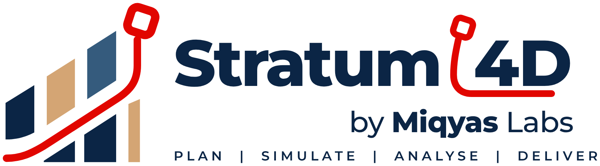

<p align="center"></p>

# Stratum 4D by Miqyas Labs

**Plan · Simulate · Analyse · Deliver.** A product of [Miqyas Labs](brand/README.md), *Engineering Intelligence*, developed by [Junaid Quamar](https://www.linkedin.com/in/junaidquamar/), Senior Planning Engineer.

Stratum links a Primavera P6 schedule to an IFC building model and plays back the construction sequence over time. It runs in the browser, as a desktop app for Windows, macOS and Linux, or on a team server.

**Try it in the browser:** [xunaidlnt-sudo.github.io/stratum-4d](https://xunaidlnt-sudo.github.io/stratum-4d/) (sign-in required). The site is rebuilt from `main` on every push; schedules you open stay in your browser.

Release 0.7 makes the P6 layout look and work like P6 Professional: a P6 Classic look (Windows chrome, P6 band colours, blue selection) and P6's command column on every dialog; the Projects window with EPS bands, Strategic Priority and baselines; P6-style Filters, Group and Sort (several levels, font and colour per level), EPS, OBS, Roles, Portfolios, Project Details (with Activity ID auto-numbering), Schedule (F9) and Schedule Options; project and resource codes, resource calendars, currency, expense categories, financial periods, WBS milestones and earned value techniques, indicator UDFs, future period bucket planning, top-down estimation, past period actuals, issue history, risk response plans, Activity Network box templates and drag-to-link, and capacity planning across a portfolio. An Android app (APK) for tablets ships with the desktop installers.

Release 0.6 also covers the enterprise side of P6: an EPS tree with several projects open at once (one network, cross-project relationships), reflections, the OBS, roles and role assignments, resource rates and limits over time, shifts, resource curves, cost accounts, budgets with a budget log, funding and spending plans, a risk scoring matrix with a heat map, and Gantt curtains and text attachments.

Release 0.6 follows the chapters of Oracle's P6 Professional and EPPM user guides (see [docs/P6_GAP_ANALYSIS.md](docs/P6_GAP_ANALYSIS.md)): Excel export/import and copy-paste of cells, a schedule log, progress lines, user preferences for units and dates, Expected Finish and Suspend/Resume, BL2/BL3 comparison baselines, custom Gantt bars with a legend, lookahead filters, threshold monitoring, step templates, notebook topics, Estimate/Remove Progress, scheduling automatically, and layout files. Release 0.5 added P6's Schedule Options (longest path, multiple float paths, out-of-sequence progress), resource levelling, calendar, activity code and UDF dictionaries, activity steps, bar dragging and linking in the Gantt chart, and Claim Digger. Release 0.4 made the P6 layout work like P6 Professional (configurable activity table, Global Change, Update Progress, baselines, Check Schedule, Activity Network, all the Directory bar windows), opens any view on another monitor with **Displays**, and schedules 25,000-activity projects in under a second. Release 0.3 added three interface modes, a project database, live Primavera P6 connections, and a dashboard and report builder with scheduled email. Everything from release 0.2 (phases 1 to 4 of the roadmap) is still there:

**4D**
- **Schedules**: Primavera P6 XER (activities, WBS, logic, codes, UDFs, calendars, constraints, actuals, baseline, resources and costs) and Microsoft Project XML.
- **Models**: IFC2x3/IFC4 via web-ifc, with name, type, GlobalId, storey, property sets and quantity sets per element.
- **Linking**: select in 3D and link, or rules such as *`Pset.ActivityID` equals Activity ID*; auto-detect finds the property that already holds activity IDs.
- **Appearance profiles**: Install, Remove, Temporary, Maintain, Neutral, plus your own; directional growth (bottom-up, west→east…) so slabs pour and walls rise.
- **Pours and bays**: split any element into parts along an axis and link each part to its own activity.
- **Equipment paths**: draw a path in 3D and a crane or truck moves along it during its activity.
- **Groups**: save selections as named groups for selection and rules.
- **Playback**: play, step, speed, data date, current vs baseline dates, colour by status (late work in red).

**Planning**
- **CPM scheduler (F9)**: FS/SS/FF/SF with lags on working calendars and holidays, nine constraint types, retained logic from the data date, total and free float, critical path, LOE/WBS summaries, loop detection, open-end warnings.
- **Activity editor**: add or delete activities; edit durations, status and actual dates, logic, constraints, calendars, user fields and resource assignments.
- **Export**: P6 XER that updates the original project (untouched tables pass straight through), or CSV for Excel.

**Cost, resources, quantities**
- **Earned value**: BAC, PV, EV, AC, SPI, CPI, EAC, VAC, TCPI; S-curves for planned, earned, actual and forecast; WBS roll-up; in cost or labour hours.
- **Resource histograms**: weekly usage per resource, actual-then-remaining or baseline.
- **Quantities**: any numeric IFC quantity (e.g. NetVolume) or element count, installed by the playback date, current vs baseline curve, by IFC type or activity.

**Output**: PNG snapshots, WebM video, `.stratum.json` project files, autosave.

Added after reading user reviews of existing 4D tools (see [docs/PARITY.md](docs/PARITY.md#user-feedback)):

- **Weekly schedule updates**: import the new XER over the open project. Links carry across by Activity ID even if P6 internal ids change, and the **Check** tab lists finish slip, status/progress changes, and added or removed activities.
- **Link health check**: activities with nothing linked, elements never shown, elements installed by two activities, and broken links (with one-click clean-up).
- **Auto-detect linking rules**: scans every model property against Activity ID, name, WBS and activity codes, then offers the best matches as one-click rules.
- **Autosave and restore**: work is saved in the browser every few seconds; after a crash or closed tab Stratum offers to restore it.
- **Getting-started guide and shortcuts**: press `?`. Space plays, arrows step a day (Shift for a week), Home/End jump.

Two sample projects show the whole workflow without any files:
- **220/33 kV GIS substation, Abu Dhabi** (fictional). It has an EPC schedule of 46 activities on a UAE 6-day calendar with public holidays, costs in AED, procurement of GIS and transformers, and a 202-element model of the GIS hall, transformer bays, control building, trenches and site works.
- **Small RC building.**

Load either from the empty workspace or the File menu. `samples/` has the RC demo as an XER and a small MS Project XML.

**User guide:** [docs/Stratum-4D-User-Guide.pdf](docs/Stratum-4D-User-Guide.pdf) (with screenshots, worked through the GIS substation example; written and credited to Junaid Quamar).

Planned work and how Stratum compares with SYNCHRO 4D Pro's public feature set are in [docs/PARITY.md](docs/PARITY.md). Development follows [docs/CLEAN_ROOM.md](docs/CLEAN_ROOM.md).

## Interface modes

The first time Stratum starts, a short setup asks which layout you want. All three share the same engine and data. The P6 and MS Project layouts are schedule-only and laid out like the originals; the 3D model, linking and playback live in the 4D layout. Switch at any time from the top bar or in **Settings → Interface**.

| Mode | Layout | Wording |
|---|---|---|
| **P6 style** | Laid out like P6 Professional, schedule only (no 3D): menu bar (File, Edit, View, Project, Enterprise, Tools, Admin, Help) and toolbar; Directory bar with the Projects, Resources, Reports, Tracking, WBS, Activities, Assignments, WPs & Docs, Expenses, Thresholds, Issues and Risks windows as tabs; a Command bar that changes with the window. The Activities window has an activity table with any of 40+ P6 columns (plus activity codes and UDFs), Group & Sort, filters, in-place editing, multi-select and a right-click menu; a Gantt chart with actual / remaining / critical / baseline / float bars, relationship lines and timescale options, or the Activity Network; saved layouts. Below: Activity Details tabs (General, Status, Resources, Predecessors, Successors, Relationships, Codes, Notebook, UDFs), Resource and Activity Usage profiles and spreadsheets, or Trace Logic | Activity ID, Original/Remaining Duration, Schedule % Complete, Total Float, Data Date; actual dates marked "A"; blue actual, green remaining, red critical bars |
| **MS Project style** | Laid out like Microsoft Project's Gantt Chart view, schedule only (no 3D): green title bar, ribbon (File, Task, Resource, Report, Project, View) with groups, Timeline, Gantt Chart with row numbers, indicators, task mode, predecessors and resource names, optional Task Form, Tracking Gantt and Resource Usage views, status bar with zoom | ID, Task Name, Duration ("15 days"), Start ("Mon 05/10/26"), Status Date, Calculate Project |
| **4D style** | 3D model in the middle, Gantt on the left, linking tools on the right, timeline along the bottom | Task ID, Focus date, Reschedule |

**P6 commands.** Edit has Undo/Redo (Ctrl+Z / Ctrl+Y), Cut/Copy/Paste activities (pasted copies get new IDs), Add (Ins), Delete (Del), Dissolve, Renumber Activity IDs, Link / Unlink (Ctrl+L), Fill Down (Ctrl+E), Select All and Assign Predecessors / Successors / Resources / Activity Codes. Tools has Global Change (If / Then / Else with a change report before anything is applied), Update Progress, Store Period Performance, Recalculate Assignment Costs, Check Schedule (the 14-point DCMA assessment, with the failing activities one click away) and spell check. Project has Schedule (F9), Maintain Baselines (store, assign, update, delete) and Assign Baselines from a file. File has Page Setup, Print and Publish Layout as HTML. **Schedule Options** (Project menu) set out-of-sequence progress (Retained Logic, Progress Override, Actual Dates), how total float is computed, critical by a float threshold or by longest path, start-to-start lag from actual or early start, open ends critical, and multiple float paths to an ending activity; driving relationships are marked and the Longest Path, Float Path and Float Path Order columns show the result. A project **Must Finish By** date drives late dates. **Level Resources** (F10) delays work in priority order until no resource exceeds its max units per hour (set in the Resources window), optionally within float or without moving the finish. Enterprise has **Calendars** (work week, holidays, working exceptions), **Activity Codes** (types, values, descriptions, colours) and **User Defined Fields**. Activities have **Steps** with weights that roll up to a physical % complete, a Percent Complete Type and a secondary constraint. In the Gantt chart, drag a bar to move it, drag its end to change the duration, or drag from the dot after a bar onto another activity to link them. **Claim Digger** (Tools) compares the project with an earlier XER / XML or a stored baseline, field by field, and exports the report to Excel. **Excel**: File → Export to Excel writes the current layout's columns to .xlsx; Import from Excel updates activities by Activity ID (and can add new ones), with a preview. Cells copy to Excel as tab-separated text and blocks pasted from Excel fill the table from the focused cell. Tools → **Schedule Log** lists the options used, out-of-sequence progress, open ends, constraints and impossible actual dates after each F9. **Edit → User Preferences** shows durations in days or hours with chosen decimals and five date formats. Maintain Baselines assigns stored baselines as **BL2 and BL3** (columns and bars); **Bar Chart Options** adds custom bars (any dates, filtered, coloured, top/middle/bottom) with a legend and a **progress line**; **lookahead** filters use dates relative to the data date (DD+14). The **Thresholds** window monitors total float, variances and durations and raises issues. Steps can be saved as **step templates**; the Notebook has **topics**. Tools has **Estimate Progress** and **Remove Progress**; Schedule Options can **schedule automatically** after each change. Layouts export and import as files, and column titles can be renamed.

**Multi-display.** **Displays** (top bar, all layouts) opens any view in its own window: Activities, the activity table on its own, the Gantt chart, an update-progress sheet, Activity Details, the Activity Network, Trace Logic, usage spreadsheets and profiles, earned value, dashboards, WBS, Assignments, Issues or Risks. Drag each window to a monitor, or use **Detect monitors** (desktop app, Chrome, Edge) to place it on a chosen screen. Every window shows the same project live: select, edit or reschedule (F9) in one and the others follow, and an edit made in a display window is one undo step in the main window. **Save current setup** remembers which views were open and where; reopen the whole arrangement in one click. Each display window keeps its own columns and layout.

**Switching and appearance.** The layout switch at the top right (P6 · Project · 4D) changes layout instantly; `Ctrl+Alt+1/2/3` does the same. The open project, selection and filters stay as they are. P6 uses light Windows-style chrome with blue actual, green remaining and red critical bars; MS Project a green title bar and ribbon with blue task bars and black summary brackets; 4D a graphite dark theme with the Stratum orange. The sun/moon button flips light and dark; **Settings → Interface** also has font, text size and density.

Fonts are bundled, so the desktop app looks the same offline. The default, **Stratum Sans**, is [Inter](https://rsms.me/inter/) set with its own stylistic alternates (single-storey a, open digits, tailed l). IBM Plex Sans, Source Sans 3, Nunito Sans and JetBrains Mono are also included, plus the system font. All are under the SIL Open Font License 1.1.

## Project database

Projects are saved to a database instead of loose files (**Save** or `Ctrl+S`, **Projects** to open). Each save gets a version number; if someone else saved the project after you opened it, Stratum refuses to overwrite their work and offers *Save as new*.

- **Desktop app**: a local SQLite file in your user folder.
- **Browser**: the browser's own storage (IndexedDB).
- **Stratum Server**: one PostgreSQL database for the whole team, with sign-in and three roles: admin (users and settings), planner (projects, dashboards, reports) and viewer (read and receive reports).

`.stratum.json` project files still work under **File**.

## Primavera P6 connections

Desktop app and Stratum Server only (the browser cannot reach a P6 server directly). Add connections in **Settings → Primavera P6**, then use **Import from P6**.

- **P6 EPPM** (web services REST API, 20.x and later): sign in with a P6 user or a bearer token. Stratum reads projects, WBS, activities, relationships, calendars, codes, UDFs, resources and assignments. **Update P6** sends progress back: actual start and finish, % complete and remaining duration. Activities added in Stratum are listed rather than pushed; take those over with an XER.
- **P6 Professional database**: SQL Server, Oracle or SQLite. Read-only by design, so use a read-only database login. Deleted rows and baseline copies are skipped. To return dates to P6 Professional, export an XER and import it with *Update Existing Project*.

**Before you connect, and when it fails.** Stratum only makes outgoing HTTPS calls to P6, so nothing needs port forwarding on the Stratum side. The machine running Stratum must be able to reach the P6 server, the same way a browser reaches the P6 web client. **Test connection** checks each link in turn and says what to fix if one breaks:
- the address;
- the server name (DNS);
- the port;
- the certificate (expired, wrong name, or issued by a company authority this machine doesn't trust);
- the REST API path;
- sign-in (wrong password, or no API module access);
- project access (OBS).

**Copy report for IT** puts the result on the clipboard.

**Company certificates and proxies.**
- **Desktop app:** P6 calls go through Electron's network stack, so they trust the Windows / macOS certificate store and use the system proxy.
- **Stratum Server:** set `NODE_EXTRA_CA_CERTS` to a PEM file holding the company root certificate, and `HTTPS_PROXY` / `NO_PROXY` if P6 must be reached through a proxy.
- **Either:** paste the root certificate into **Company certificate** on the connection.

Passwords are stored encrypted: with the operating-system keychain in the desktop app, and with AES-GCM keyed by `STRATUM_SECRET` on the server. They are never sent back to the browser.

## Training mode

**Learn** (beside the layout switch, or Help → Training Mode) opens ten hands-on lessons, about 70 minutes in all, that run on the live application with the 220 kV GIS sample:

- Getting started: a first look around, reading one activity, the MS Project layout;
- Planning skills: critical path and float, the weekly progress update, adding an activity and its logic;
- Project controls: baselines and variance, cost, resources and earned value;
- 4D and reporting: 4D simulation, dashboards and reports.

A coach card explains one idea at a time and highlights where it is on screen. Task steps ("set the Filter to Critical", "set % complete to 45") tick themselves off when the app sees the change; **Show me** does the step for you; short quizzes check understanding. Numbers on the cards are read live from the project. A searchable glossary of 38 planning terms, with their MS Project equivalents, sits beside the lessons, and progress is remembered on each computer.

## Dashboards and reports

**Reports** sits in the top-bar switch next to P6 · Project · 4D (Ctrl+Alt+4) and opens a Power BI-style builder. Start from a template (Planning dashboard, EPC progress report, Project status), a blank page, your own saved templates or an imported dashboard file. Then click **Customise**:

- drag a card's title bar to move it and its corner to resize it (1–12 columns wide, half-row heights); duplicate, remove, undo and redo (Ctrl+Z / Ctrl+Y);
- a side panel with **Data** (measure, grouping, weighting, period, decimals, prefix/suffix, green and red limits), **Look** (accent colour, card background, filled or underlined title bar, card style, text size, alignment, line or shaded area, legend, which series to show) and **Filter** (limit one widget to a discipline or code value, follow or ignore the slicers);
- activity tables with your choice and order of columns, including any activity code, plus a default sort; readers can click headings to sort;
- **Page & theme**: Stratum, EPC report or Executive (dark) theme, main colour, background, card style, spacing, header and subtitle with `{project}` and `{datadate}`, company logo, footer, A4 landscape or portrait for the PDF;
- **More**: duplicate, save as template, export the dashboard as a file to share, delete.

Widgets:

- numbers: KPI tile, gauge (SPI, CPI, % complete against plan), key-figures table, status donut (progress status, float bands, critical share);
- charts: cost/labour S-curve, progress S-curve with period bars, one S-curve per phase (E, P, C…), plan vs actual by discipline, resource histogram, quantity curve;
- tables: activity table, milestone tracker (baseline vs forecast, days late, on track / at risk / late), 1–12 week look-ahead grouped by week, weighted progress table (Cum. BL Plan %, Cum. Actual %, Variance wrt BL) with a shaded **TOTAL** row, portfolio across all projects;
- layout: section banner, text note, image or logo, slicer buttons by discipline, package or any activity code.

**Project control dashboards (EPPM style).** Two templates reproduce the monthly project-control pages used on P6 EPPM projects:

- *Project control – summary*: key dates (contract, baseline, estimated), schedule adherence index, a weighted-percent gauge with the baseline plan marked, scope weightage by discipline, progress summary (estimated and actual FTM, baseline and estimated UTM, actual to date), project durations in months (baseline, estimated, elapsed, remaining, overrun) and a discipline table (criteria weight, baseline plan, actual, BL variance, baseline and estimated finish, duration variance in working days). Click a row or a pie slice to filter the page.
- *Project control – S-curve*: baseline, actual and remaining weight % with monthly histograms and data labels on one % axis, a date-range slider, and list slicers for discipline, work package, package and domain.

Progress is weighted by a progress-weightage resource (use *Labour hours*), cost, duration or equally. New dashboards pick up P6 user fields or activity codes named Discipline, Work Package, Package and Domain. Use **Project → Assign Baselines** (MS Project: *Project → Set Baseline from File*) to take baseline dates from the approved-baseline XER by Activity ID, as P6's Assign Baselines does; the status bar shows which baseline is in use.

Progress is weighted by budgeted cost, labour hours, duration or equally, and grouped by WBS level 1 or 2, any activity code or any user field. You can type your own weightage per group (e.g. General 3%, Engineering 7%, Procurement 50%, Construction 40%); the TOTAL row then uses those weights.

Every dashboard prints to PDF (A4, in the orientation set on the page) and exports to Excel (summary, progress table, progress S-curve, late and critical, 3-week look-ahead, all activities, S-curve data, weekly resources, portfolio).

**Email reports**: send a dashboard now, or on a daily, weekly or monthly schedule, to any To/Cc list, as PDF, Excel or both. Subjects take `{project}`, `{date}` and `{datadate}`. Mail goes out through your SMTP server (Settings → Email); each run is logged with its result. Schedules run while the desktop app is open, or around the clock on a Stratum Server.

## Stratum Server (team mode)

```bash
cp .env.example .env      # set STRATUM_SECRET and POSTGRES_PASSWORD
docker compose up -d      # PostgreSQL 16 + Stratum Server on port 8080
```

Open `http://<server>:8080`, create the first admin account, then point each user's setup (or Settings → Database) at that address. Without Docker: `npm run build && npm run build:server`, then `DATABASE_URL=postgres://… STRATUM_SECRET=… npm run server`. Leaving out `DATABASE_URL` uses a SQLite file (`STRATUM_DB_FILE`). PDF reports on the server need Chromium; the Docker image includes it.

## Running it

Needs Node.js 20 or newer.

```bash
npm install
npm run dev        # http://localhost:5173
npm test           # engine, database, P6 connector, server and report tests
npm run build      # production build in dist/
```

## Desktop app and installers

Stratum also ships as a desktop app (Electron). It runs the same code as the web version, works offline, and registers `.xer` and `.ifc` files so double-clicking one opens it in Stratum.

```bash
npm run desktop      # build and run the desktop app locally
npm run dist:win     # Windows installer  -> release/Stratum-4D-<version>-win-x64.exe
npm run dist:mac     # macOS disk image   -> release/Stratum-4D-<version>-mac-<arch>.dmg
npm run dist:linux   # Linux AppImage + .deb
```

Each installer has to be built on its own OS (or with Wine for Windows). The GitHub Actions workflow in `.github/workflows/desktop.yml` builds all three on native runners on every push, and attaches them to a draft GitHub Release when you push a `v*` tag.

The Windows installer lets the user pick the install folder and adds Start-menu and desktop shortcuts. Installers are **unsigned** for now, so Windows SmartScreen shows "Windows protected your PC" (click *More info → Run anyway*) and macOS needs right-click → *Open* the first time. Code-signing certificates remove both warnings.

Brand files live in `brand/`: the wordmark for light and dark backgrounds, and the app icon as SVG and 1024 px PNG. `build/icon.png` (installer and window icon) and `public/favicon.svg` are copies of the icon.

## Linking tips

- The quickest route is a shared key. If the model has a property holding the P6 Activity ID (for example `Pset_Stratum.ActivityID`, or an ArchiCAD/Revit shared parameter), one *equals* rule links the whole model.
- Zone- or storey-based schedules: give activities a P6 activity code (e.g. `Zone`) and match it to the IFC `Storey` or a zone property.
- One element can link to several activities, for example *install* under one task and *remove* under a later one. During playback, an active task takes precedence, then the most recently finished task, then the next task due to start.

## Layout

```
src/core/      schedule model, XER/MSPDI, CPM, EVM, progress weighting, reporting model, demo data
src/viewer/    three.js viewport and IFC loader
src/ui/        React UI: the three layouts, Gantt, timeline, dialogs, dashboards and widgets
src/backend/   where data lives: browser storage, desktop app, or Stratum Server
src/services/  database repository (SQLite/PostgreSQL), SMTP, Excel, report scheduler, P6 connectors
src/server/    Stratum Server (Fastify): API, sign-in and roles, PDF rendering
electron/      desktop shell and its local services
tests/         vitest tests
docs/          parity tracker and clean-room policy
```

## Known limits

- The CPM engine follows P6's default options (retained logic, finish float, predecessor-calendar lags). Progress override, resource levelling is a single-pass serial leveller (no resource curves or splitting), and multiple float paths use relationship free float.
- The P6 layout covers the Activities workspace and the windows on the Directory bar. Not yet there: EPS / portfolio hierarchy with several open projects, roles, OBS and user security, the Reports wizard (use Dashboards), Timescaled Logic Diagrams, resource curves, and P6's per-period spreads in Store Period Performance (Stratum keeps actuals-to-date per period).
- Display windows open from the main window and need it to stay open; the 3D model cannot yet be shown in a display window.
- Costs and quantities are spread linearly over each activity's elapsed time, so weekly figures can differ slightly from P6's calendar-weighted spread.
- XER export has been checked by re-importing into Stratum, not yet in a live P6 database: use P6's import preview the first time.
- Very large IFC files (hundreds of MB) still load slowly; GPU instancing and level-of-detail are planned.
- Video export is WebM only (browser MediaRecorder).
- The P6 EPPM connector has been tested against a mock of the documented REST API, and the P6 database reader against SQL Server 2022 and SQLite copies of the P6 schema. Try both against a test P6 database before production use.
- Oracle P6 databases use the same queries as SQL Server but have not been run against a live Oracle instance yet.

## Author

Stratum 4D was conceived, specified and directed by **Junaid Quamar**, Senior Planning Engineer (Primavera P6 project controls and cost engineering for HV substation, transmission and rail electrification projects). The feature set, priorities and planning workflows come from Junaid's project-controls practice.

- LinkedIn: https://www.linkedin.com/in/junaidquamar/

## Licence

Proprietary. Copyright © 2026 Junaid Quamar. All rights reserved. Third-party libraries keep their own licences (three.js MIT, web-ifc MPL-2.0, React MIT, zustand MIT).
